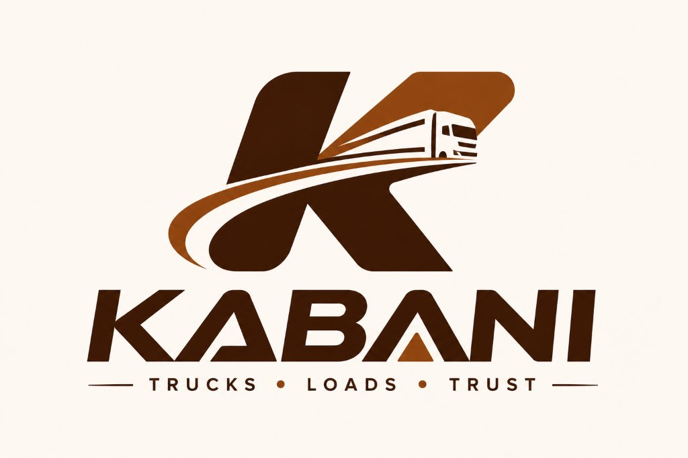
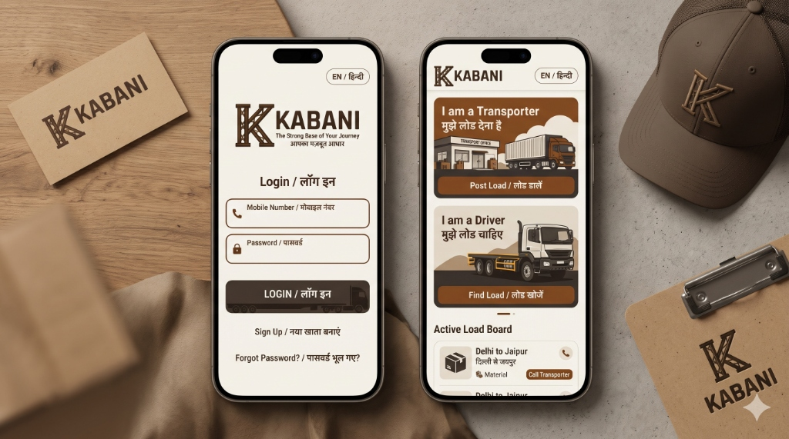

# KABANI (कबानी) — Shyam Freight Carriers PWA

> **RELIABLE TRUCK NETWORK** | **VERIFIED TRANSPORT NETWORK**  
> *TRUCKS • LOADS • TRUST*

[](https://ssccgl3377.github.io/shyam-freight-carriers/)
[](#playwright-cli-assurance)
[](#smartphone--mobile-os-optimizations)
[-blue.svg)](#strict-language-localization)

A modern, tactile Progressive Web App (PWA) designed and engineered specifically for truck drivers, transport contractors, and freight booking offices across India. Built for **Shyam Freight Carriers** under the **KABANI** brand identity.

🌐 **Live GitHub Pages URL**: [https://ssccgl3377.github.io/shyam-freight-carriers/](https://ssccgl3377.github.io/shyam-freight-carriers/)

---

## 📸 Brand Visual Identity

| Official Logo & Motif | Reference Mockup |
|:---:|:---:|
|  |  |

### Color Logic & Aesthetics
- **Kraft Sand Canvas (`#FBF8F3` / `#F5ECE1`)**: Warm tactile foundation reminiscent of physical transport bilty (consignment notes) and desk stationery.
- **Deep Espresso (`#2E180E`)**: Solid headings, structural borders, and physical letterpress button depths.
- **Cognac Leather (`#8D5028`)**: Accent badges, transporter role cards, and cargo tags.
- **Forest Action Green (`#1B6A34`)**: Exclusively reserved for primary **"Call Transporter"** action buttons, live ping indicators, and available load statuses.
- **Muted Stone Slate (`#78716C`)**: Neutral indicator for booked/assigned loads.

---

## 🎯 Core UX & Business Directives

1. **Visual-First Navigation**:
   - Designed for low-literacy environments with universally recognizable iconography (trucks, location pins, phone receivers, cargo crates, password locks).
   - Massive 56px+ touch targets conforming to field conditions in moving vehicles or noisy transport yards.

2. **Direct Communication (0% Commission / No Digital Bidding)**:
   - Eliminates complex online bidding calculators and commission deduction tracking.
   - Prominent 1-tap green call buttons trigger direct phone calls (`tel:+91...`) for offline rate negotiations.

3. **Strict Password-Based Authentication**:
   - Mobile Number + Password login.
   - Mobile Number + Email + Password registration.
   - Password recovery via registered Email Address.
   - **Strictly NO OTP-based UI** for reliable offline/field sign-in.

4. **Voice Assistance**:
   - Web Speech API integration allowing drivers to listen to load origin, destination, material, and weight spoken aloud in Hindi or English with a single tap.

---

## 🌐 Strict Language Localization

- **English Mode**: **100% Pure English**. Zero Devanagari script or Hindi text across headers, form fields, badges, or load cards.
- **Hindi Mode**: Standard UI localized into Hindi with **phonetic transliteration** for industry and cargo terms (avoiding awkward literal translations):
  - `Transporter` ➔ **ट्रांसपोर्टर**
  - `Driver` ➔ **ड्राइवर**
  - `Party` ➔ **पार्टी**
  - `Load` ➔ **लोड**
  - `Assigned` ➔ **असाइंड**
  - Material categories:
    - *Agricultural Produce* ➔ **एग्रीकल्चर प्रोड्यूस (अनाज / सब्जी)**
    - *Construction Materials* ➔ **कंस्ट्रक्शन मटेरियल (सीमेंट / ईंट)**
    - *Industrial Goods* ➔ **इंडस्ट्रियल गुड्स (लोहा / स्टील)**
    - *FMCG / Packaged Goods* ➔ **एफएमसीजी / पैकेज्ड गुड्स (पैक्ड सामान)**
    - *Machinery* ➔ **मशीनरी (भारी पार्ट्स / उपकरण)**
    - *Textiles* ➔ **टेक्सटाइल्स (कपड़ा / गांठ)**
    - *Chemicals / Liquids* ➔ **केमिकल्स / लिक्विड (टैंकर / ड्रम)**

---

## 🎨 Huashu Motion Graphics & Scroll Craft

- **Interactive Cruising Mini-Truck**: A live mini-truck graphic (`#highway-scroll-indicator`) glides along the top progress track in sync with the user's scroll depth.
- **Highway Road Lane Animation**: Moving dashed centerlines (`.road-lane-anim`) with traveling pulse dots (`.route-pulse-dot`) illustrating freight moving from origin to destination.
- **Sonar Ripple Rings**: Concentric pulsing rings (`.sonar-ring-1`, `.sonar-ring-2`) on the Forest Green call button to draw natural eye focus.
- **Snap-Scroll Quick Filter Chips**: Smooth horizontal snap carousel for single-touch filtering by material type.
- **Infinite-Scroll Stream**: `IntersectionObserver`-backed seamless freight stream feeding live loads as the driver scrolls.

---

## 📱 Smartphone & Mobile OS Optimizations

- **iOS & Android Safe Area Insets**:
  - Built with `viewport-fit=cover` and CSS variables `--sat` (`env(safe-area-inset-top)`) and `--sab` (`env(safe-area-inset-bottom)`) for iPhone Dynamic Island, notch, and Android gesture navigation bars.
- **Touch & Gesture Physics**:
  - `-webkit-tap-highlight-color: transparent` and `touch-action: manipulation` eliminating double-tap 300ms delay.
  - Tactile button press depth simulation (`active:translate-y-0.5`).
  - Haptic feedback pulses (`navigator.vibrate(12)`) on button taps.
- **Standalone PWA Meta**:
  - `apple-mobile-web-app-capable: yes` and `theme-color: #2E180E`.

---

## 🧪 Playwright CLI Assurance

All core features, localizations, and mobile interactions are covered by an automated Playwright test suite (`test-features.spec.js`):

```bash
npx playwright test --reporter=list
```

### Verified Test Results (7/7 Passed):
```text
Running 7 tests using 1 worker

  ✓ 1. Branding, Official Logo & Dual Taglines (4.8s)
  ✓ 2. Authentication: Password-based Login, Sign-up & Forgot Password via Email (5.4s)
  ✓ 3. Language Localization: English Mode (Zero Devanagari) vs Hindi Mode (Transliterated) (4.9s)
  ✓ 4. Transporter Dashboard: Post Load Form & "Mark as Assigned" Status Toggle (7.5s)
  ✓ 5. Driver Load Board: Stream, Filters, Direct Calling & Voice Assist (3.9s)
  ✓ 6. Scroll Craft: Scroll Progress Bar & Infinite Scroll Batching (6.6s)
  ✓ 7. Huashu Motion Graphics & Smartphone (iOS / Android) Optimizations (4.0s)

7 passed (40.1s)
```

---

## 🚀 Quick Start

### 1. Prerequisites
- [Node.js](https://nodejs.org/) (v18+)

### 2. Installation & Run
```bash
# Clone the repository
git clone https://github.com/ssccgl3377/shyam-freight-carriers.git
cd shyam-freight-carriers

# Install dependencies (Playwright testing)
npm install

# Start the local server
node server.js
```

Open `http://127.0.0.1:3000` in your smartphone or desktop browser.

### 3. Run Automated Tests
```bash
npx playwright test --reporter=list
```

---

## 📄 License
ISC © Shyam Freight Carriers / KABANI. All rights reserved.
